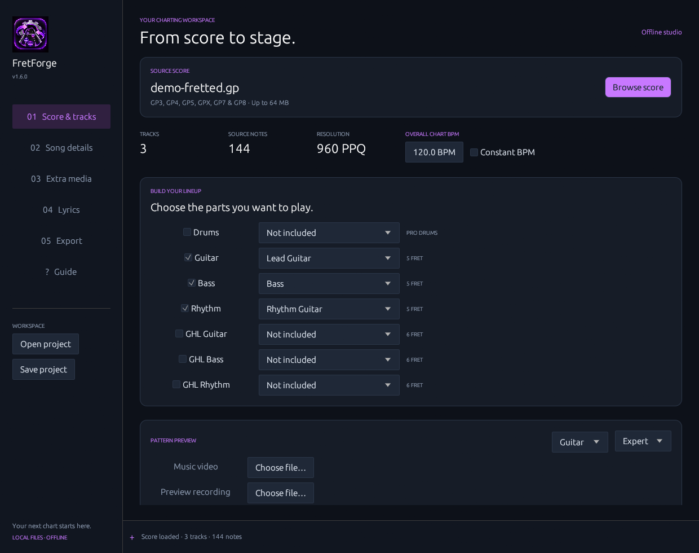
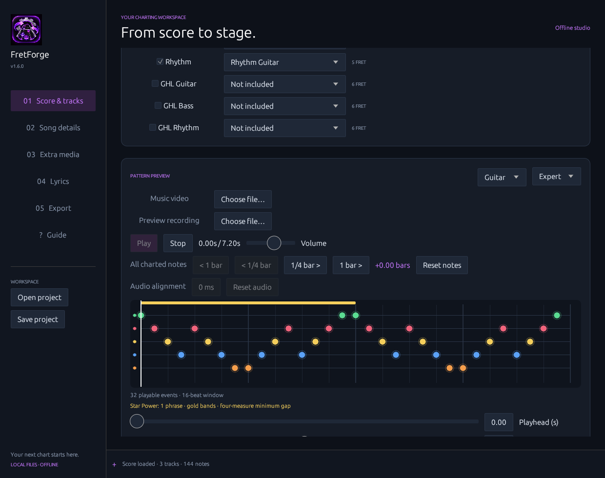
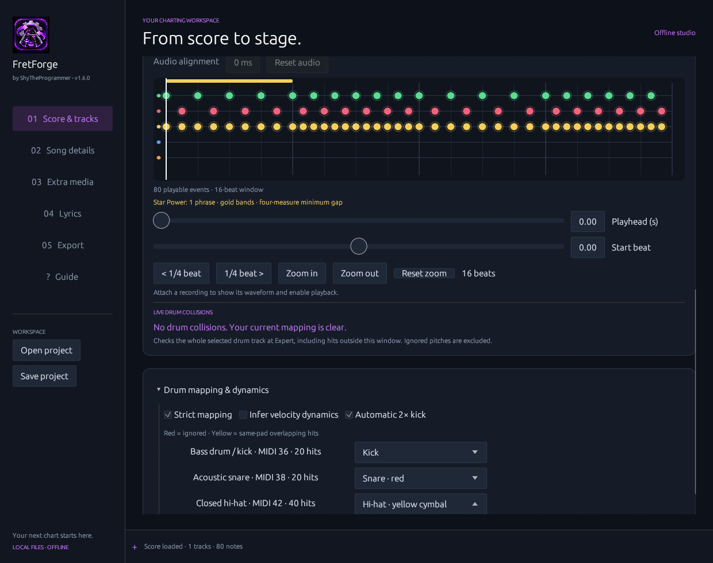
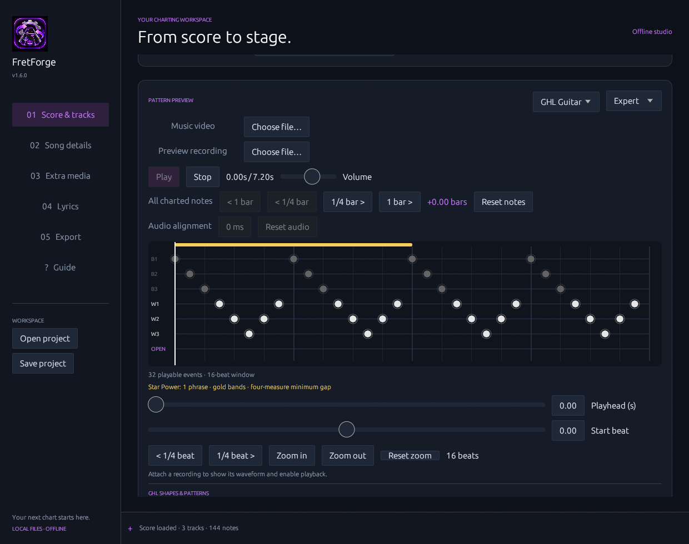

<div align="center">

# 🎸 FretForge

**Turn Guitar Pro scores into editable Clone Hero charts.**

A Windows desktop charting tool for guitar, bass, rhythm, drums, and Guitar Hero Live six-fret parts—with difficulty generation, timing tools, lyrics, Star Power, and media support.

[](LICENSE)


[Features](#features) · [Getting started](#getting-started) · [Workflow](#recommended-workflow) · [Build](#building-from-source) · [Documentation](#documentation)



</div>

> [!IMPORTANT]
> **Generated charts require review.** FretForge converts score notation into a useful starting point; it does not automatically transcribe or synchronize a recording. Open the exported `notes.chart` in [Moonscraper](https://github.com/FireFox2000000/Moonscraper-Chart-Editor), check timing and all enabled parts/difficulties, then playtest in Clone Hero.

## What is FretForge?

FretForge is a native Windows desktop application with a Rust interface and conversion engine. It imports Guitar Pro scores, helps you map and preview playable note charts, and exports a Clone Hero song folder with optional audio, lyrics, artwork, and other media. Guitar Pro decoding uses a bundled JavaScript/alphaTab bridge.

## Features

- **Guitar Pro import:** GP3, GP4, GP5, GPX, and GP7/8 scores, including playback-map repeats and tuplets.
- **Multiple instruments:** five-fret Guitar, Bass, Rhythm and Pro Drums; optional six-fret GHL Guitar, Bass and Rhythm.
- **Four difficulties:** generate Easy, Medium, Hard and Expert with instrument-specific reduction rules.
- **Charting assistance:** fret mapping, chord and sustain handling, HOPO/strum markers, Expert taps where applicable, and automatic Star Power placement.
- **Drum mapping:** named source sounds, cymbal flags, ghost/accent dynamics, collision diagnostics and kick handling.
- **Audio synchronization:** waveform-backed note preview, playback controls, millisecond audio alignment, and shared chart shifts.
- **Lyrics:** create, import and edit standard or enhanced LRC, TTML phrases, and plain TXT; align lyrics to audio and review repaired timestamps.
- **Media packaging:** recording, video, artwork, backgrounds, highways, icons, stems and other optional assets.
- **Local stem separation (optional):** install a private Demucs environment and generate stems from a recording.
- **Reviewable output:** conversion reports, charting warnings, JSON project saves, and in-app help.

### Interface previews

| Charting workspace | Drum mapping |
| --- | --- |
|  |  |



## Getting started

### Requirements

- **Windows** (the documented and validated release platform).
- A Guitar Pro score (`.gp3`, `.gp4`, `.gp5`, `.gpx`, or supported GP7/8 file).
- Optionally, a matching audio recording and other song assets.
- **Moonscraper** for final chart editing and review.

The **portable Windows release** bundles the required Node.js and FFmpeg runtimes. You do **not** need to install Rust, Node.js, FFmpeg, or Python to run the main application. Python is only needed if you choose to set up optional local stem separation.

### Install and launch

1. Obtain the **Windows portable release package** from the project's [Releases page](https://github.com/forgesuiteapps/FretForge/releases), if a release is available. The GitHub source ZIP is **not** a prebuilt application.
2. Extract the **entire** portable package into a folder.
3. Run `FretForge.exe`.
4. Keep the included `vendor/`, `gp_bridge.cjs`, and `examples/` beside the executable; do not move the EXE on its own.

If no portable release is available, [build from source](#building-from-source).

## Recommended workflow

1. **Import a score.** Drag and drop a Guitar Pro file, browse to it, or try an included demo.
2. **Select tracks.** Assign the desired Guitar, Bass, Rhythm, Drums or GHL parts. Check note previews, drum mappings and collision warnings.
3. **Configure the song.** Set metadata, enabled difficulties, overall BPM, optional constant-tempo behavior, and instrument ratings.
4. **Align a recording.** Add matching audio in Pattern Preview, play it against the chart, and adjust the waveform alignment or enter a precise offset. You can also shift all charted notes together.
5. **Add optional content.** Import/edit LRC, TTML or TXT lyrics and attach artwork, video, backgrounds, or audio stems.
6. **Export.** Select a destination and create the song package.
7. **Review and playtest.** Open `notes.chart` in Moonscraper, inspect timing, notes, sustains, Star Power, lyrics and every difficulty, then test the song in Clone Hero.

**Timing note:** Changing BPM changes the chart's musical timing grid; it does **not** time-stretch the recording. Audio alignment may add silence to the beginning of exported audio or trim its beginning. Originals are left unchanged.

## Exported files

Depending on the enabled options, an exported song folder can include:

```text
Your Song/
├── notes.chart                 # Generated note chart
├── song.ini                    # Song metadata and instrument ratings
├── song.wav                    # Exported/aligned audio, when applicable
├── lyrics.lrc                  # Aligned lyrics, when supplied
├── conversion-report.json     # Conversion details and decisions
├── CHARTING-REVIEW.txt         # Items requiring chart review
├── LYRIC-REVIEW.txt            # Lyric timing review, when applicable
└── ...                         # Optional media and assets
```

The exact output depends on your inputs and export selections. If no recording is provided, FretForge can create a silent practice WAV.

## Optional: local stem separation

In **Extra media**, choose a song recording (or active music video), then use **Install stem tools** and **Separate song & assign stems**.

- Requires an existing **Python 3.10 or 3.11** installation for initial setup.
- Installs pinned CPU PyTorch, torchaudio and Demucs dependencies in a **private environment** in the folder you choose.
- Setup needs internet access and several gigabytes of disk space; subsequent processing runs **locally** without uploading your audio.
- Uses Demucs `htdemucs_6s`; generated vocal, guitar, bass and drum stems are assigned, with a backing mix based on the remaining sources.
- Separation quality varies. Listen to and verify the generated stems before exporting.

Stem tools are **not included** in the portable ZIP, and the main application works without them.

## Building from source

Only the Windows build is documented as validated by the project.

### Prerequisites

- Stable [Rust toolchain](https://rustup.rs/).
- Windows native build tools; the MSVC toolchain with Visual Studio C++ Build Tools is recommended.
- Node.js and FFmpeg available on `PATH`, **or** the corresponding Windows runtime binaries copied from the portable release into `vendor/`.

The source archive does not include the large bundled runtime executables.

### Build and test

```powershell
cargo test --locked
cargo build --release --locked
```

The release executable is built at `target/release/fretforge.exe`. For a portable layout, copy it to the repository's runtime folder as `FretForge.exe`, keeping `gp_bridge.cjs`, `vendor/`, and `examples/` alongside it and ensuring the required Node.js/FFmpeg executables are available.

Run the included end-to-end demo export check:

```powershell
.\FretForge.exe --smoke-test
```

This writes demo exports to `smoke-output/`.

Other useful launch options:

```powershell
.\FretForge.exe --demo
.\FretForge.exe --demo-drums --demo-audio
.\FretForge.exe --demo-lyrics --page=5
```

## Known limitations and review requirements

- **Not a one-click finished chart:** automated mappings, difficulty reductions, drum collisions, sustain decisions and Star Power placements may need correction.
- **Not audio transcription:** note timing comes from the Guitar Pro playback map, not automatic detection of notes in the recording.
- **Recording alignment is separate from BPM:** tempo edits do not stretch audio.
- **GHL mapping is heuristic:** six-fret patterns and chord shapes should be checked on a controller.
- **Lyrics are timing/text data:** pitched vocal gameplay and `notes.mid` export are not supported.
- **Custom assets may need installation:** content under `Extras/Custom` may require separate installation in the target game.
- **Windows-first:** no macOS or Linux release is provided or validated in the repository documentation.

## Documentation

For detailed behavior and conversion policies, see:

- [Charting rulebook](CHARTING-RULEBOOK.md)
- [Five-fret ruleset](5_fret_charting_ruleset.md)
- [Six-fret ruleset](6_fret_charting_ruleset.md)
- [GHL patterns reference](GHL_All_Notes_and_Common_Patterns.md)
- [Rulebook implementation](RULEBOOK-IMPLEMENTATION.md)
- [Validation](VALIDATION.md)
- [Original guide](ORIGINAL-GUIDE.md)
- [Changelog](CHANGELOG.md)
- [Third-party notices](THIRD-PARTY-NOTICES.md)

## Contributing and feedback

Bug reports, reproducible charting issues, and feature suggestions are welcome through [GitHub Issues](https://github.com/forgesuiteapps/FretForge/issues). When reporting a conversion issue, include the application version, input format, affected instrument/difficulty, steps to reproduce, and relevant review/report output where you have permission to share it. Do not upload copyrighted scores or recordings without authorization.

## License and acknowledgments

FretForge is distributed under the [MIT License](LICENSE). The project uses **alphaTab** for Guitar Pro import and bundles third-party runtimes and libraries subject to their respective licenses. See [Third-Party Notices](THIRD-PARTY-NOTICES.md) and the license files under `vendor/` for details. Optional Demucs-based stem separation has its own dependency and model licensing considerations.

---

<div align="center">

**Import → Map → Align → Export → Review → Play**

</div>

## Expert chart difficulty generator

Open **Difficulties** to select an Expert-only Clone Hero `.chart` file, preview note counts, and save a separate copy with Easy, Medium and Hard. Guitar, Bass, Rhythm, Drums and GHL parts are supported. Song, timing, global events and Expert sections are preserved. Existing lower difficulties are rejected so they cannot be overwritten accidentally. MIDI input is not supported. Reductions simplify spacing, chords and fret range and require review and playtesting.

TTML Line/Phrase timing imports one complete lyric event per paragraph; Word timing imports each word at its source span time, grouped into its original phrase (adjacent syllables join into words at the first syllable timestamp). TTML accepts bare decimal seconds and paragraph start times with mm:ss.mmm or hh:mm:ss.mmm clock times and h/m/s/ms offset notation, including inherited timing. lrc.red lyric TTML uses absolute song clock times, preserving line timing without adding parent timestamps. Frame/tick-based TTML needs conversion first. Plain TXT starts with provisional three-second line spacing; edit and align each line in Lyrics before exporting. Timed LRC saved as `.txt` retains its timestamps. Imported formats export as LRC.
